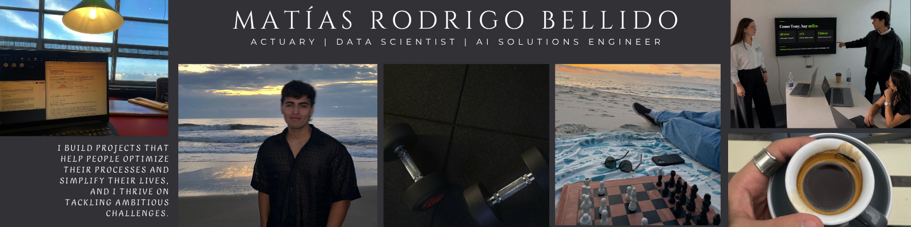
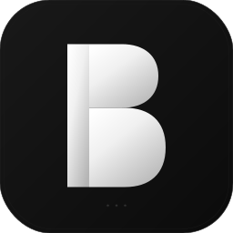

  

 

  
  &nbsp;&nbsp;
  
  &nbsp;&nbsp;
  

---

<h1 align="center">Hi, I'm Matías Rodrigo Bellido </h1>

  

## 🧭 Summary

I'm an Actuarial Science student at FCE-UBA (University of Buenos Aires), halfway through the degree. Alongside it I build projects that mix statistics, optimization and software: a regression study of Argentina's AL30D bond against GDP, a linear-programming meal planner fed by live supermarket prices, and LLM agents that handle customer service and lead qualification for small businesses.

I start from a business question, pick the method that fits it, and check the result before I report it.

 

| | |
|---|---|
| 📍 Based in | Buenos Aires, Argentina |
| 🎓 Studying | Actuarial Science, FCE-UBA |
| 🗣️ Languages | Spanish (native), English (C1) |
| 🛠️ Daily tools | Python, R, SQL, Excel Solver, n8n |
| 🚧 Right now | Co-building LLM agents for SMEs at Budgents. Taking Statistical Analysis II. |

> [!TIP]
> Open to internships and junior Data Analyst or Data Scientist roles, especially at startups and firms that make decisions from data.

---

## 🧰 Core Stack & Tools

#### Data & Statistics
 &nbsp;
 &nbsp;
 &nbsp;
 &nbsp;
 &nbsp;
 &nbsp;
 &nbsp;
 &nbsp;

#### Analytics & BI
 &nbsp;
 &nbsp;
 &nbsp;

#### AI & Automation
 &nbsp;
 &nbsp;
 &nbsp;
 &nbsp;
 &nbsp;
 &nbsp;

#### Engineering
 &nbsp;
 &nbsp;
 &nbsp;
 &nbsp;
 &nbsp;
 &nbsp;

 

---

## 🚀 Featured Projects

### 📉 GDP vs. the AL30D Bond · Applied Statistics Pipeline

> Does Argentina's real GDP move its AL30D sovereign bond? A reproducible Python analysis for Análisis Estadístico II (FCE-UBA), built with a team of five. On the monthly sample (n = 56, GDP from INDEC interpolated with a spline) there is no evidence of a linear association (β₁ = 0.0154, p = 0.994). The quarterly sample (n = 19) rejects H0 at p = 0.014, but removing a single quarter, 2024Q1, moves it to p = 0.053.

Methods: simple and multiple regression, ANOVA, confidence intervals, goodness-of-fit tests, Cook's distance and leave-one-out diagnostics.

**Stack:**  &nbsp;  &nbsp; 

 &nbsp; 

 

### 🥗 NutriOps · Linear Programming Meal Optimizer

> Many of my personal-training clients can't stick to a diet without overspending at the supermarket. NutriOps treats meal planning as a resource-allocation problem: a linear program finds the cheapest combination of foods that hits the daily macro targets, using prices and stock scraped from large supermarket chains in Buenos Aires.

**Stack:**  &nbsp;  &nbsp; 

 

### 📐 Constrained Utility Optimizer · Lagrange Multiplier Engine

> Maximizes a nonlinear utility function under a budget constraint with SciPy's SLSQP, and reads the Lagrange multiplier as a shadow price: how much utility one extra unit of budget buys. Useful for resource-allocation decisions.

**Stack:**  &nbsp;  &nbsp; 

 

### 🤖 Budgents · AI Agents for SMEs

> A modular set of LLM agents that handle B2B customer service, lead qualification and appointment scheduling for small and medium businesses, shortening their sales cycle. I co-founded it and moved the stack from Make to n8n, with webhooks and Supabase. It runs at 3+ SMEs.

**Stack:**  &nbsp;  &nbsp;  &nbsp; 

 

### 💸 ZIRA-AI · Financial Reconciliation Agent

> A local AI agent that automates the monthly match between receipts and bank statements for small accounting firms. It flags duplicate charges, mismatched amounts, unexplained fees and possible fraud, and all inference runs on the device, so confidential financial data never leaves the machine. Built in 24 hours.

**Stack:**  &nbsp;  &nbsp;  &nbsp; 

 &nbsp; 

 

### 🧠 Symbiosis AI · Execution Intelligence for Goal-Driven Individuals

> Closes the gap between intention and execution: it turns objectives into structured action plans, tracks progress and adapts priorities as things change. Validated with 80+ surveyed students before the first line of code.

**Stack:**  &nbsp;  &nbsp; 

 &nbsp; 

### More builds

| Project | What it does | Stack |
|---|---|---|
| [**Signal**](https://github.com/matiasbellidor/signal) | Bilingual (ES/EN) news diary on AI, startups, tech and science. Reads 38 feeds from 23 outlets, groups stories about the same event, ranks them, and adds a Claude summary checked against the source, always linking the original. | Next.js 16, PostgreSQL, Drizzle, Vitest, Playwright |
| [**Vibear**](https://github.com/matiasbellidor/Vibear-) | Upload a photo of an outfit: YOLOv8 segmentation finds each garment and FashionCLIP ranks buyable products by visual similarity. Built for Argentine stores and prices in ARS, on a US$0/month budget. | Next.js, FastAPI, YOLOv8, FashionCLIP, Docker |
| [**trends-agent**](https://github.com/matiasbellidor/trends-agent) | Pulls trends from Hacker News, Reddit, GitHub, arXiv, YouTube and RSS, scores each item (50% relevance, 30% engagement, 20% recency) and writes a daily Markdown digest on a GitHub Actions schedule. | Python, GitHub Actions |
| [**AgroCow**](https://github.com/Goat-Builders/agrocow) | Hackathon team project (HackaTwin, Buenos Aires, November 2026). Computer-vision prototype for cattle monitoring: YOLO11 detection and ByteTrack tracking, time spent in feeding and drinking zones, and three rule-based alerts for vet review. My part: code audit, README and the [pitch site](https://agrocow.vercel.app). | Python, YOLO11, ByteTrack, Vite |
| **Bellido's Brand** (private) | Content-intelligence platform: scans 41 active sources (RSS, arXiv, Crossref, GitHub, Hacker News), keeps the evidence behind each idea and tracks video performance. Every metric comes from an observation or a visible formula. Daily scheduled job. | Next.js, SQLite/libSQL, Drizzle |
| [**Portfolio site**](https://github.com/matiasbellidor/matiasbellido-) | Bilingual (ES/EN) portfolio at [matiasbellido.vercel.app](https://matiasbellido.vercel.app), with landing pages for Bellido Asesoramientos. Accessibility checked with axe, performance measured with Lighthouse. | Next.js 14, TypeScript, Tailwind, Framer Motion |
| [**Bellido Importaciones**](https://matiasbellido.vercel.app) | Capital-efficiency model for cross-border B2C retail without stock on hand: capture price differences across markets while keeping locked capital and operational risk low. | Pricing models, logistics |
| [**OneiricAi** and **NexStock**](https://matiasbellido.vercel.app) | OneiricAi: hackathon project on generative-AI video, biometrics and product strategy. NexStock: ITBA bootcamp project on operations and processes. | See portfolio |

---

## 🧪 How I Work

- Numbers in a write-up come from the code. In the AL30D project the conclusion is generated from the results file, and a test fails if the text and the computed numbers drift apart.
- A surprising result gets stress-tested before it gets an interpretation. The quarterly rejection of H0 looked solid until leave-one-out and Cook's distance showed that one quarter drove it, so I reported it as fragile.
- Documentation says what the code does not do. The AgroCow README states that the feeding zone is measured at the animal's feet, not at its head, and that there is no accuracy evaluation yet.

 

---

## 💼 Experience

| Period | Role | What I did |
|---|---|---|
| 2025 – present | Co-Founder & Chief AI Architect, **Budgents** | LLM agents for first contact, lead qualification and scheduling at small businesses. Moved the stack from Make to n8n with webhooks and Supabase. 3+ SMEs. |
| 2023 – present | Founder, **Bellido Asesoramientos** | Fitness coaching (IFBB Academy and ISSA certified personal trainer) and tutoring in Calculus, Linear Algebra and Descriptive Statistics for first-year UBA students. 70+ people coached: 30+ in fitness and 40+ students. |
| Dec 2024 – Nov 2025 | Customer Experience, **Arcos Dorados** | Standardized processes under time and efficiency metrics in a high-volume operation. Solved problems at peak demand with the rest of the team. |
| Aug – Dec 2024 | Business Development, **SomeClub** | CRM and sales-funnel analysis. |
| Feb – Aug 2024 | Commercial Consultant, **FIAT Argentina** | Full sales cycle in the automotive sector against monthly targets, with consultative negotiation and objection handling. |
| Aug – Dec 2023 | Research Assistant (intern, ACAP program), **Fundación Apolo** | Source search and synthesis, and executive summaries on public policy. |

---

## 🎓 Education & Certifications

**Actuarial Science** at FCE-UBA, University of Buenos Aires (halfway through the degree).

| Area | Credentials | Issuer |
|---|---|---|
| 🧠 AI engineering | Model Context Protocol: Advanced Topics Introduction to Model Context Protocol Introduction to Agent Skills Introduction to Subagents | Anthropic |
| ⚙️ Applied AI | Claude Code in Action Claude Code 101 Claude Platform 101 | Anthropic |
| 💬 AI fluency | AI Fluency: Framework & Foundations AI Fluency for Students AI Fluency for Educators Introduction to Claude Cowork Claude 101: Everyday Work Tasks | Anthropic |
| 📊 Data science | Data Science Methodology Data Science Tools | IBM |
| 📊 Data science | Introduction to Data Science | Santander Open Academy |
| 💼 Business | Finance | FEMSA |
| 💼 Business | Agile Management Strategic Negotiation Storytelling | Santander Open Academy |
| 🏋️ Personal training | Certified Personal Trainer | IFBB Academy, ISSA |

---

## 👾 Contribution Graph

  <picture>
    <source media="(prefers-color-scheme: dark)" srcset="https://raw.githubusercontent.com/matiasbellidor/matiasbellidor/output/pacman-contribution-graph-dark.svg" />
    <source media="(prefers-color-scheme: light)" srcset="https://raw.githubusercontent.com/matiasbellidor/matiasbellidor/output/pacman-contribution-graph.svg" />
    
  </picture>

---

## 📬 Connect

  
  &nbsp;&nbsp;
  
  &nbsp;&nbsp;
  

  

  <i>© 2026 Matías Rodrigo Bellido.</i>

